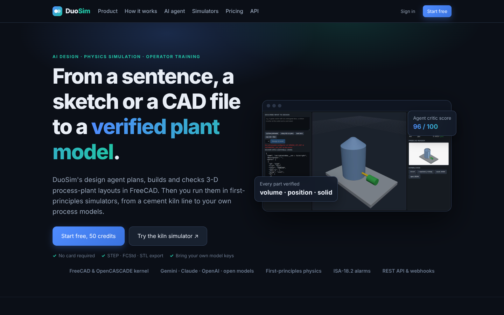
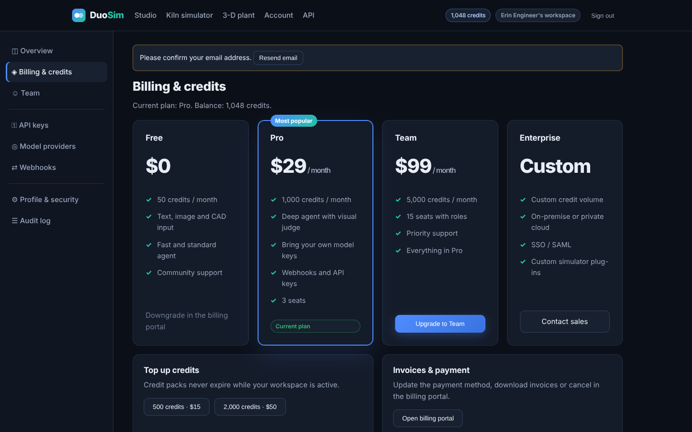
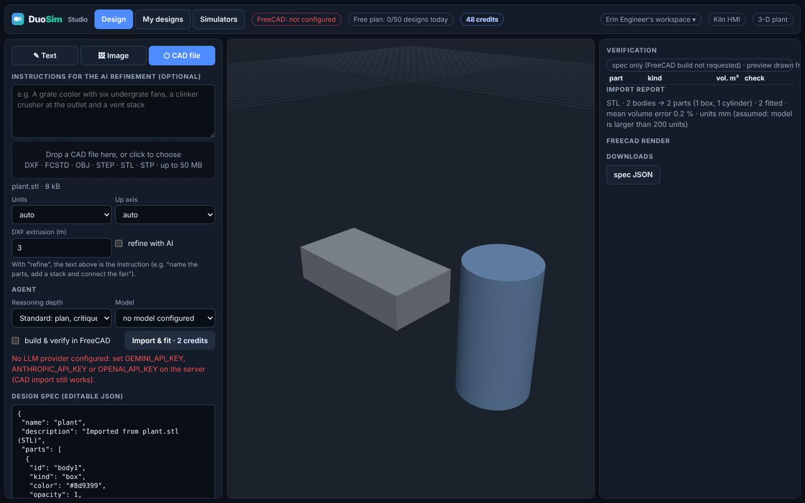

# DuoSim as a commercial SaaS

This page describes what makes the simulator a sellable product: accounts, organisations, credits, plans,
billing, administration, security and operations. It also lists what is still missing before a public launch.

## Product surface

| Path | What |
|---|---|
| `/` | Landing page: product, how it works, AI agent, simulators, live pricing (from `/api/billing/plans`), FAQ |
| `/signup`, `/login`, `/forgot`, `/reset`, `/verify` | Account pages |
| `/app` | Studio: design from **text**, **reference images** or a **CAD file**, agent depth, model choice (platform or own keys), agent trace, history, simulators |
| `/account` | Overview, billing & credits, team, API keys, model providers (BYOK), webhooks, profile & security, audit log |
| `/admin` | Platform KPIs, users (admin / suspend), workspaces (plan, credits, suspend), audit log |
| `/hmi`, `/3d` | Cement kiln operator HMI and live 3-D plant (flagship simulator) |
| `/docs` | OpenAPI reference of every endpoint |
| `/terms`, `/privacy` | Legal **templates** that need review by counsel before launch |
| `/healthz`, `/readyz` | Liveness and readiness probes |

| Landing | Billing | Studio (CAD import, preview without FreeCAD) |
|---|---|---|
|  |  |  |

## Architecture

```
browser ──cookie session + X-DuoSim-CSRF──┐
scripts ──X-API-Key: ds_…─────────────────┤
                                          ▼
         FastAPI (duosim.server)
           ├─ api_saas      auth · account · billing · admin
           ├─ api_design    generate (agent) · build · import · history      ──► model providers (Gemini, Claude,
           ├─ api_platform  simulator sessions                                   OpenAI, OpenAI-compatible, BYOK)
           └─ pages         landing, studio, account, admin, legal           ──► FreeCAD worker (internal network)
                │
                ▼
         SQLite (WAL): workspaces · api_keys · designs · usage · users · memberships · sessions · tokens
                       credit_ledger · billing_events · audit_log · provider_keys · webhooks
```

All of it is standard library plus `cryptography`. The schema migrates itself (`duosim/saas/schema.py`).
SQLite in WAL mode handles one app instance well. Several app instances need a shared database (see *Gaps*).

## Identity and access

* **Passwords**: scrypt (N=2^15, r=8, p=1, 16-byte salt). Parameters are stored per hash and upgraded on sign-in. Minimum 10 characters.
* **Sessions**: a 256-bit random token in an `HttpOnly`, `SameSite=Lax` cookie (and `Secure` behind TLS). Only the SHA-256 is stored. Sessions last 30 days. A password change signs out other devices, and a reset or a suspension signs out all of them.
* **CSRF**: every state-changing request authenticated by the cookie must send `X-DuoSim-CSRF: 1`. A cross-site form or script cannot add a custom header without a CORS pre-flight, and this server grants none.
* **API keys** (`ds_…`, legacy `cs_…` still accepted): created and revoked by workspace admins, stored as SHA-256, and shown once.
* **Roles**: `owner` (billing, roles) > `admin` (members, keys, providers, webhooks) > `member` (design, simulate). A workspace always keeps at least one owner.
* **Invitations**: emailed single-use links (14 days). Seats are limited by plan.
* **Email**: verification (optionally required, `DUOSIM_REQUIRE_VERIFIED_EMAIL=1`) and password reset (1 h). The forgot-password flow never reveals whether an account exists. SMTP via `DUOSIM_SMTP_URL`, otherwise mail is logged.
* **Rate limits**: sign-in 30/h per IP and 10/h per email, sign-up 10/h per IP, and the reset and verification mails are limited too.
* **Platform admins**: `DUOSIM_ADMIN_EMAILS` or `python -m duosim.platform users admin <email>`.

## Credits, plans and billing

Every billable operation is priced in credits and debited **before** work starts, using a conditional `UPDATE … WHERE
credits >= cost` and a ledger row in the same transaction. Concurrent requests therefore cannot overspend (there is a test with 8 threads).
If the model provider or the FreeCAD worker fails, the charge is refunded and the refund is a ledger row too.

| Operation | Credits |
|---|---|
| Design, fast / standard / deep agent | 2 / 4 / 10 |
| Design with the workspace's own model key (any mode) | 1 |
| Reference images (per request) | +2 |
| FreeCAD build, verification and exports | 1 |
| CAD / mesh import and primitive fit | 2 |
| Simulator session | 1 |

Override with `DUOSIM_CREDIT_COSTS='{"generate.deep": 12}'`. Turn metering off for private installs with `DUOSIM_CREDITS=0`.

| Plan | Price | Credits / month | Seats | Concurrent sessions | Features |
|---|---|---|---|---|---|
| Free | $0 | 50 | 1 | 2 | text, image and CAD input; fast and standard agent |
| Pro | $29 | 1,000 | 3 | 5 | + deep agent, own model keys, webhooks |
| Team | $99 | 5,000 | 15 | 20 | + priority |
| Enterprise | contact | 20,000+ | unlimited | 100 | + SSO, private deployment |

Credit packs: 500 for $15 and 2,000 for $50. Monthly allowances top the balance up to the plan amount and do not accumulate. Purchased credits are kept.

**Billing providers** (`DUOSIM_BILLING`):

* `stripe`: Checkout (subscriptions and one-off packs) and the Customer Portal, called over HTTPS without an SDK. Credits are granted **only from signature-verified webhooks** (`Stripe-Signature`, 5-minute tolerance), and every event id is processed once. Handled events: `checkout.session.completed`, `customer.subscription.created/updated/deleted`, `invoice.paid`. Configure `STRIPE_SECRET_KEY`, `STRIPE_WEBHOOK_SECRET` and `DUOSIM_STRIPE_PRICE_<PRO|TEAM|PACK_500|PACK_2000>`, and point the Stripe webhook at `/api/billing/webhook`.
* `mock`: purchases apply immediately (demos and the browser tests). **Never use it in production.**
* unset: no online payment. Admins change plans and credits in `/admin` or with `python -m duosim.platform plan|credits`.

## Connectors

* **Model providers**: platform-wide from the environment (`GEMINI_API_KEY`, `ANTHROPIC_API_KEY`, `OPENAI_API_KEY`, and any OpenAI-compatible endpoint through `DUOSIM_PROVIDERS`), or per workspace (Pro and above). Workspace keys are encrypted with AES-256-GCM; the key is derived with HKDF from `DUOSIM_SECRET_KEY` or a generated `secret.key` (mode 0600), and each ciphertext is bound to its workspace. Custom endpoints must be https with public addresses (SSRF policy).
* **Webhooks**: `design.completed`, `design.failed`, `import.completed`, plus a test `ping`. Payloads are JSON signed like Stripe's (`DuoSim-Signature: t=…,v1=HMAC-SHA256("t.body")`). Delivery is retried 3 times with back-off, and the destination is re-checked against the SSRF policy before every attempt.
* **REST API**: everything in the UI. Interactive reference at `/docs`.

## Privacy and compliance features

* Data export (JSON) and account erasure. Workspaces the user owns alone are deleted with their designs; shared workspaces are handed to another member. The user's audit entries are anonymised.
* An audit log of security-relevant actions (sign-up, sign-in, keys, providers, members, plan, billing, admin actions).
* Security headers on every response: CSP (first-party scripts only, no `eval`), `X-Frame-Options`, `nosniff`, `Referrer-Policy`, `Permissions-Policy`, and HSTS behind TLS.
* The model never writes code: generated geometry is a validated JSON spec, uploaded CAD is parsed as data, and FreeCAD documents are never opened as documents.

## Operating it

```bash
cp .env.example .env    # model keys, DUOSIM_SECRET_KEY, DUOSIM_ADMIN_EMAILS, SMTP, Stripe
docker compose up --build
# or: uv run duosim --port 8000 --freecad 127.0.0.1:9875
python -m duosim.platform users list | users admin <email> | credits <ws> <delta> | plan <ws> <plan>
```

Behind a reverse proxy, set `DUOSIM_TRUST_FORWARDED=1`, `DUOSIM_COOKIE_SECURE=1` and `DUOSIM_PUBLIC_URL=https://…`.
Use `/readyz` for the load balancer.

## Gap analysis

What a complete commercial SaaS needs, and where this repository stands.

| Area | Status |
|---|---|
| Landing page, pricing, FAQ, legal pages | **built** (legal texts are templates) |
| Sign-up / sign-in / reset / verification | **built** |
| Organisations, roles, invitations, seats | **built** |
| Credits ledger, plans, packs, refunds | **built** |
| Payments (Stripe Checkout, Portal, webhooks) | **built** (needs a Stripe account and price ids) |
| Admin console, audit log, operator CLI | **built** |
| API keys, webhooks, BYOK model keys | **built** |
| Data export / erasure | **built** |
| Multimodal input (images, CAD) | **built** |
| Agentic design with verification | **built** ([AGENT.md](AGENT.md)) |
| Browser end-to-end tests of the product | **built** (`tests/validation/e2e_saas.py`, part of `scripts/ci_e2e.sh`) |
| Multi-instance database (PostgreSQL) | **missing**: SQLite limits the app to one instance |
| Job queue and FreeCAD worker pool | **missing**: builds run in the request, on one worker per URL |
| Per-tenant operator HMI | **missing**: `/hmi` drives one shared simulator. Tenants use `/api/platform/sessions` |
| SSO (SAML / OIDC), 2FA | **missing** (Enterprise) |
| Tax / VAT, invoices beyond Stripe's | **missing**: use Stripe Tax |
| Usage alerts (`credits.low`) | event defined, emitter not wired yet |
| Observability (metrics, tracing), backups | **missing**: run SQLite backups (`.backup`) and an uptime check on `/readyz` |
| Legal review, DPA, sub-processor list | **operator task** |
